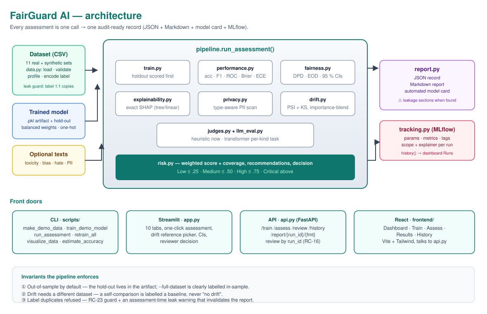
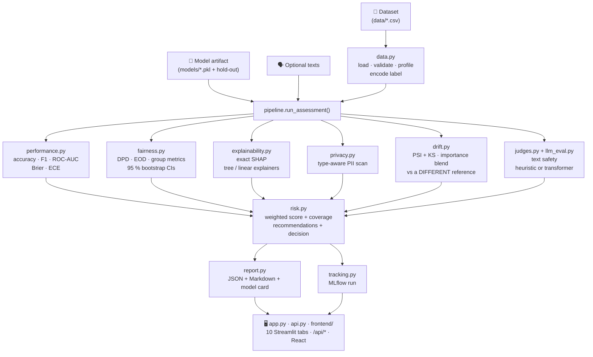
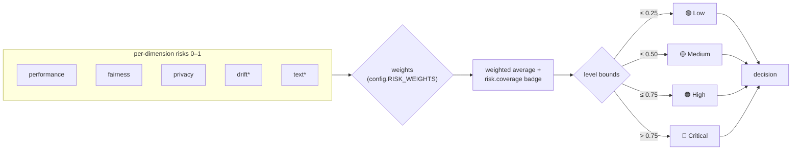
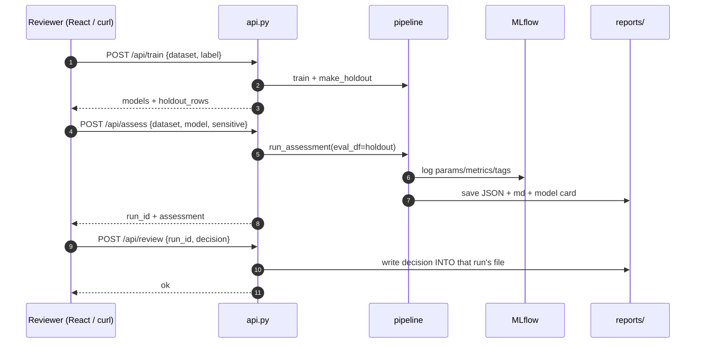
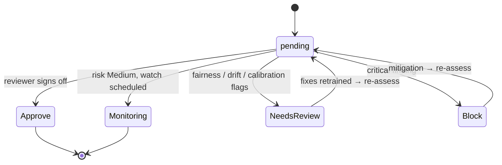
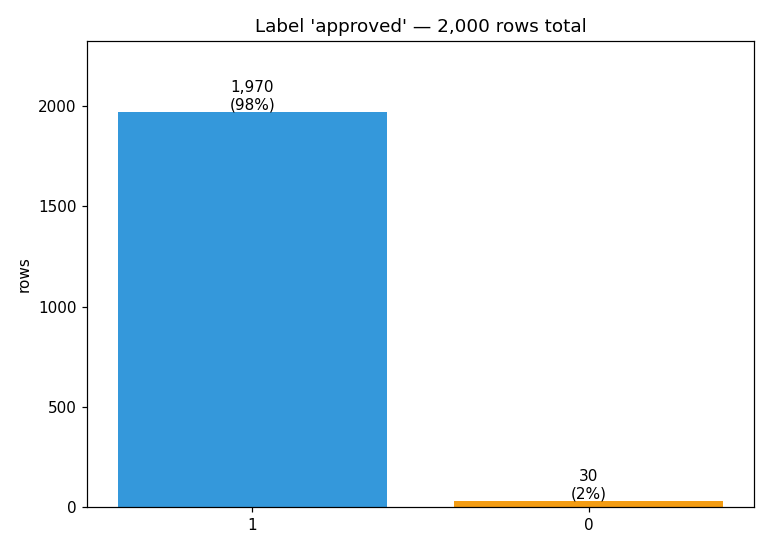
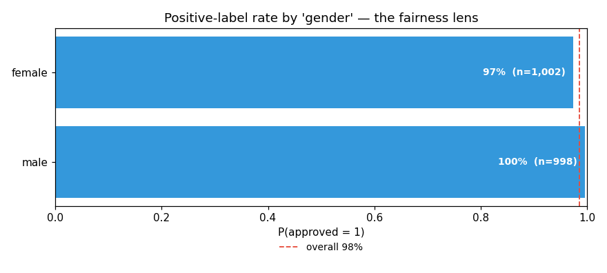
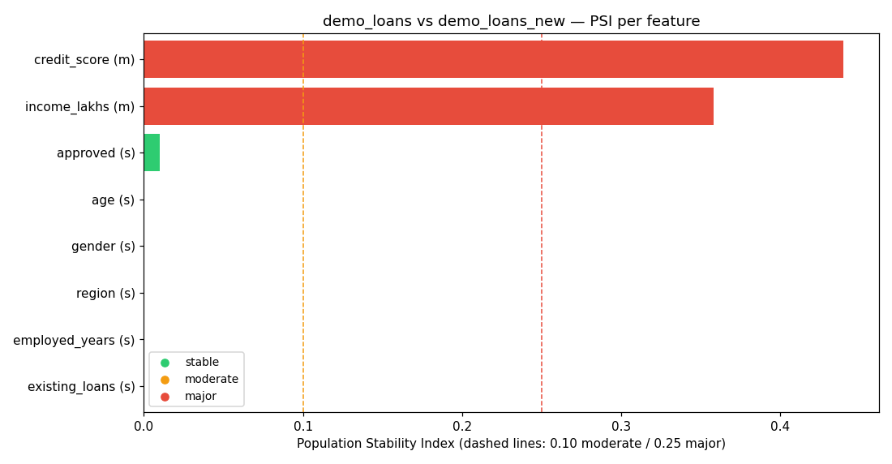

<div align="center">

# 🛡️ FairGuard AI

**Responsible-AI Assessment Workbench**
*Fairness · Explainability · Privacy · Drift · Performance · Text safety — one call, one audit-ready record*

[](https://github.com/Meet6338-X/FairGuard/actions/workflows/tests.yml)
[](#running-the-tests)
[](https://www.python.org/)
[](https://scikit-learn.org/)
[](https://shap.readthedocs.io/)
[](https://fairlearn.org/)
[](https://mlflow.org/)
[](https://streamlit.io/)
[](#project-info)

**Team Gear5thCoders · Group 119 · Vishwakarma Institute of Technology, Pune**

**Tech stack** — everything runs locally, no keys, no cloud:

`pandas` · `NumPy` · `scikit-learn` · `SHAP` · `Fairlearn` · `MLflow` · `Streamlit` · `FastAPI` · `React` · `Vite` · `Tailwind CSS` · `Plotly` · `Matplotlib` · `Pytest`

</div>



FairGuard evaluates machine-learning models *beyond accuracy*. It measures fairness,
explainability, privacy risk, data/model drift, performance and text/LLM safety,
combines the results into one risk score with actionable recommendations, records
every assessment in MLflow, and presents everything in an interactive Streamlit
dashboard with an audit-ready report and an automated model card.

| 📖 Documentation | |
|---|---|
| **[USER_MANUAL.md](USER_MANUAL.md)** | every command, step by step, copy-paste ready |
| **[EXPLAIN.md](EXPLAIN.md)** | how the whole project works, module by module |
| **[visualize.md](visualize.md)** | the data — every chart in `visualize/` and what it tells you |
| **[ROOT_CAUSES.md](ROOT_CAUSES.md)** | the 24 root causes found in the audit and how each was fixed |
| **[UPDATE.md](UPDATE.md)** | update log + the transformer text-judge rollout plan |

| Dimension | What it checks | Method |
|---|---|---|
| Fairness | Group-wise metrics, disparity, and 95 % bootstrap confidence intervals | Fairlearn |
| Explainability | Global feature importance + per-prediction explanation | SHAP (exact Tree/Linear explainers) |
| Privacy | PII / sensitive columns and privacy-risk summary | Type-aware detectors (+ optional model) |
| Drift | Distribution shift between reference and current data, weighted by feature importance | PSI + KS test |
| Performance | Accuracy, precision, recall, F1, ROC-AUC, Brier, calibration error, confusion matrix | scikit-learn |
| Text / LLM safety | Toxicity, bias, hate speech, hallucination, PII in text | HF classifiers or built-in heuristics |
| Risk | Weighted risk score Low → Critical, recommendations, deployment decision, **coverage** | Threshold engine |
| Tracking | Every run logged with params, metrics and artifacts | MLflow |

## How everything works

### 1 · One assessment, end to end



### 2 · The risk engine

Every dimension produces a 0–1 risk. The engine weights them, reports **how much
of the weight was actually assessed** (coverage), and picks a deployment decision:



*\* dimensions that were skipped (no reference dataset, no texts) drop out of
the average — that is exactly why every score carries its `coverage` (RC-05).*

### 3 · A reviewer talks to the API



### 4 · The review workflow



Two rules the pipeline enforces:

- **The model is scored out-of-sample by default.** The hold-out split lives in
  the model artifact, so the accuracy in the report is measured on rows the
  model never saw. Use `--full-dataset` to compare against the in-sample number.
- **Drift needs a different dataset.** Comparing a dataset with itself makes
  every PSI exactly 0, which looks like "no drift" but means nothing. Pass
  `--reference <other.csv>`; a self-comparison is explicitly labelled a baseline.

## Quickstart

```bash
python -m pip install -r requirements.txt

# 1. synthetic demo dataset (biased, with PII columns and a drifted version)
python scripts/make_demo_data.py

# 2. train the three baseline models into models/
python scripts/train_demo_model.py

# 3. run a full assessment from the command line
python scripts/run_assessment.py --data data/demo_loans.csv --model models/logistic_regression.pkl --sensitive gender

# 3b. add a real drift baseline (a different dataset)
python scripts/run_assessment.py --sensitive gender --model models/gradient_boosting.pkl \
    --reference data/demo_loans_new.csv

# 3c. (optional) refresh EVERY artifact in models/ with the current code —
#     hold-out split, one-hot categoricals, balanced weights, leakage guard
python scripts/retrain_all.py

# 4. or open the interactive dashboard
streamlit run app.py
```

Full step-by-step instructions, every CLI flag, every API endpoint and a
troubleshooting table are in **[USER_MANUAL.md](USER_MANUAL.md)**.

## Datasets

The demo runs on a synthetic loan CSV the project generates itself. For real
data, four open datasets from the UCI ML Repository and ProPublica download
with one command (no account or API key needed):

```
python scripts/download_datasets.py
```

| File | Label column | Sensitive column | Source |
|---|---|---|---|
| `data/adult.csv` | `income_gt_50k` | `sex` (also `race`, `age`) | UCI — Adult / census income |
| `data/german.csv` | `credit_good` | `sex` | UCI — Statlog German credit |
| `data/taiwan_credit.csv` | `default_next_month` | `gender` | UCI — credit card default |
| `data/compas_two_years.csv` | `two_year_recid` | `race` (also `sex`) | ProPublica — COMPAS recidivism |
| `data/bank_marketing.csv` | `subscribed` | `age_group` (also `age`) | UCI — bank marketing |
| `data/student_performance.csv` | `G3_pass` | `sex` | UCI — student performance |
| `data/heart.csv` | `disease` | `sex` | UCI — Cleveland heart |
| `data/communities.csv` | `high_violent_crime` | `majority_white` | UCI — Communities and Crime |
| `data/australian.csv` | `credit_approved` | `gender_like` | UCI — Statlog Australian Credit |

Example on real data (files are git-ignored; regenerate any time, personal
name columns are dropped by the converter):

```
python scripts/train_demo_model.py --data data/adult.csv --label income_gt_50k --sensitive sex
python scripts/run_assessment.py --data data/adult.csv --label income_gt_50k --sensitive sex --model models/adult_logistic_regression.pkl
```

## Models

Every dataset gets three model types — `logistic_regression` (median-imputed
and standardized), `random_forest`, and `gradient_boosting` (sklearn
histogram trees), all wrapped in sklearn pipelines so real CSVs with stray
`?`/NaN values train and predict without extra preparation. Low-cardinality
categorical columns are one-hot encoded instead of being dropped, and the
class weights are balanced so an imbalanced target does not silently produce
a useless model.

```
python scripts/train_demo_model.py --data data/bank_marketing.csv --label subscribed --sensitive sex --model-type gradient_boosting
```

Best **hold-out** accuracy per dataset (24 models fully trained):

| Dataset | Best model | Accuracy |
|---|---|---|
| student_performance | logistic_regression | 0.927 |
| heart | gradient_boosting | 0.868 |
| bank_marketing | gradient_boosting | 0.888 |
| adult | gradient_boosting | 0.846 |
| taiwan_credit | gradient_boosting | 0.820 |
| german | logistic/gradient_boosting | 0.712 |
| communities | logistic/random_forest | 0.850 |
| australian | logistic_regression | 0.844 |
| demo loans | gradient_boosting | 0.992 |
| compas_two_years | logistic_regression | 0.682 |

The demo set trains to 0.948 (logistic regression), 0.990 (random forest) and
0.992 (gradient boosting) on the 500-row hold-out split.

The bank marketing converter drops the `duration` column on purpose — it
leaks the target (call length is known only after the call), a documented
trap of that dataset.

## Results on real data

Assessing the best model per dataset with the current code (**hold-out scope**,
65 % coverage — no drift dimension unless a reference dataset is supplied):

| Dataset | Best model | Hold-out accuracy | Risk | Decision |
|---|---|---|---|---|
| adult | gradient_boosting | 0.829 | Medium | Approve with monitoring |
| heart | random_forest | 0.855 | Medium | Approve with monitoring |
| communities | logistic_regression | 0.850 | High | Needs review |
| australian | logistic_regression | 0.827 | Medium | Approve with monitoring |
| taiwan_credit | gradient_boosting | 0.755 | Low | Approve |
| german | logistic_regression | 0.692 | High | Needs review |
| compas_two_years | logistic_regression | 0.675 | Medium | Approve with monitoring |
| demo loans | gradient_boosting | 0.992 | High (with drift) | Needs review |

Notable fairness findings from the same runs: Communities and Crime flags a
sharp violent-crime gap by racial-majority group, German credit flags a large
sex gap, and Adult's 0.829 out-of-sample accuracy is well below the bogus
**1.000** the previous code reported — the raw `income` column shipped beside
the derived label was a leak, and `fairguard.train.label_duplicate_columns`
now refuses to train on it (RC-23 in
**[ROOT_CAUSES.md](ROOT_CAUSES.md)**). Assessments **repeat** that check: a
model trained on leaky features is loudly flagged in its report, not just
silently dropped at training time. After any change to `fairguard/train.py`,
run `python scripts/retrain_all.py` so every artifact in `models/` carries
the current semantics.

These decisions differ from earlier project notes that scored every dataset
as High risk: those numbers came from **in-sample** scoring and from a drift
check that compared the dataset with itself. Out-of-sample scoring and a real
reference dataset produce the table above.

On the synthetic demo, measured with the current code:

| Run | Scope | Accuracy | Risk | Decision | Coverage |
|---|---|---|---|---|---|
| logistic regression, no drift reference | hold-out (500 rows) | 0.948 | 0.53 High | Needs review | 65 % |
| gradient boosting + drifted reference | hold-out (500 rows) | 0.992 | 0.73 High | Needs review | 85 % |

The second row is the honest result: once a **real** drift baseline is
supplied and the equalized-odds gap is taken into account, the demo model
needs review rather than a rubber stamp. The score also carries its
**coverage** — 65 % means the drift dimension was not assessed at all, so the
number is not comparable with a run that did assess drift.

## Project layout

```
fairguard/        assessment modules (one responsibility per file)
scripts/          demo data, demo training, CLI assessment, retrain sweep, data visualizations
tests/            unit + integration tests (125)
pytest.ini        pytest warnings config (keeps the console output clean)
app.py            Streamlit dashboard
api.py            FastAPI backend for the React frontend
frontend/         React + Vite + Tailwind single-page app
start.bat / stop.bat  Windows one-click start / stop for all three services
data/, models/    generated at runtime (not committed)
visualize/        99 generated data-exploration charts (regenerate: python scripts/visualize_data.py)
mlruns/           MLflow tracking store (local sqlite db, created on first run)
reports/          exported assessment reports (created on first run)
```

## Data visualizations

One gallery, **100 charts**, one story per dataset. The full walkthrough lives in
**[visualize.md](visualize.md)** — what each chart shows, what to look for, and
the red flags to catch *before* training a model.

```bash
python scripts/visualize_data.py                 # every dataset (~1 min)
python scripts/visualize_data.py --only adult    # a single dataset
```

<p>
  
  
  
</p>


`visualize/` gets one folder per dataset with nine charts for knowing the
data: label balance, numeric distributions, categorical counts, which
features move the label, a correlation heatmap, missing values, the
positive-label rate per sensitive group (the fairness lens), box plots by
class and a scatter of the two strongest features. Two extras: PSI drift
between `demo_loans` and `demo_loans_new`, and the heuristic text-judge
scores for `sample_texts.csv`. `visualize/README.md` explains how to read
every chart and flags pre-training red flags (a sensitive column high in
the label-correlation chart predicts a fairness finding; a feature 1:1 with
the label is the RC-23 leak the pipeline now refuses).

## Running the tests

```bash
python -m pytest tests -q          # 125 tests, ~30 s, fully offline
python -m pytest tests -q -k fairness   # one dimension
```

The suite covers every dimension *and* every root cause that was found:
explainer selection, hold-out scoping, fairness confidence intervals,
calibration, type-aware privacy scanning, drift aggregation, the risk engine
and the API's review endpoint. CI runs it on every push and pull request
(`.github/workflows/tests.yml`).

## Notes

- No paid APIs or API keys are required. Text judges run locally through Hugging
  Face `transformers` when it is installed; otherwise lightweight heuristic
  judges are used, so the workbench always runs offline. The rollout plan for
  the model-backed judges is in **[UPDATE.md](UPDATE.md)**.
- Fairness results are statistical measurements of *this model on this dataset*.
  They are not conclusions about protected groups of people.
- The audit that produced this version of the codebase found 24 root causes
  (wrong SHAP explainer, train/test contamination, categorical features silently
  dropped, fairness checks that ignored equalized odds, drift measured against
  itself, privacy false positives on ID columns, and more). All of them are
  documented with measurements and fixes in
  **[ROOT_CAUSES.md](ROOT_CAUSES.md)**.

## Project info

- Course: Project 23 — Responsible AI Bias, Explainability & Privacy Assessment Workbench
- Guide: Mr. Kishor Pathak
- Members: Meet Shah (2), Vaishnavi Pawar (18), Purva Waykole (20), Dipak Pote (32)
